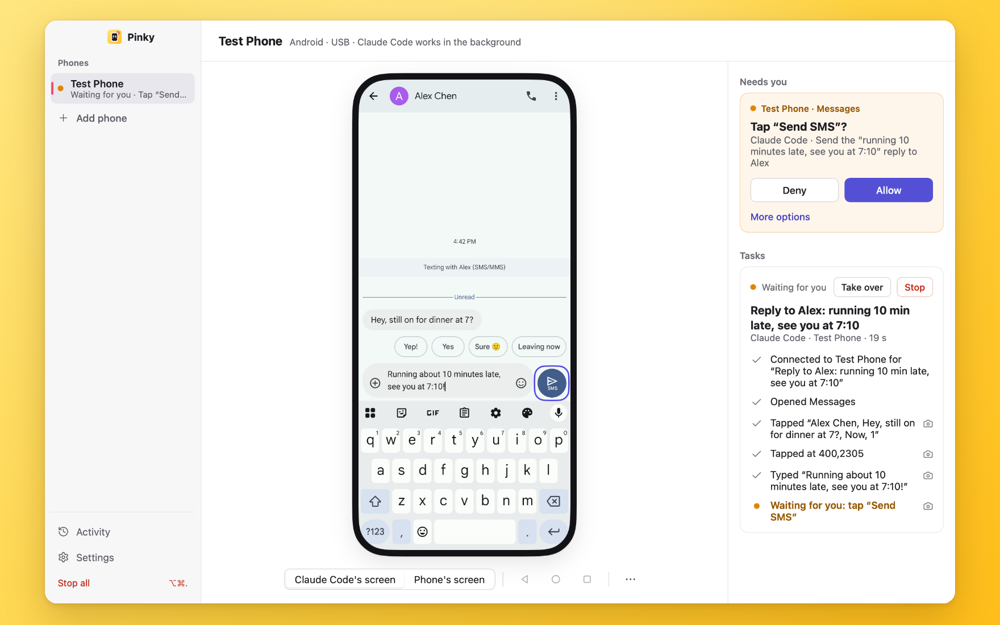
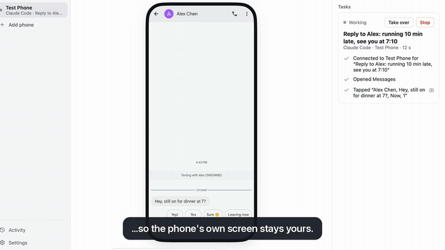

<p align="center"></p>
<h1 align="center">Pinky</h1>
<p align="center"><b>Let any AI agent use your iPhone or Android phone, from macOS, Windows or Linux, with you in the loop.</b></p>
<p align="center"></p>

Pinky lets any agent (Claude Code, Codex, Cursor or a script) operate a real iPhone or Android phone over MCP, while you watch on your computer, approve risky steps, take over and review what happened. Approvals are enforced by Pinky's gateway, not by instructions to the agent.

<p align="center"><br><sub>A real Claude Code run on an Android 16 emulator.</sub></p>

- **Every platform.** One app for macOS (Apple silicon and Intel), Windows and Linux. It drives Android phones (Android 10 to 17) and iPhones on iOS 27 or later, with nothing to install on the iPhone.
- **Tiny and native.** The window is drawn by [MyGo](https://github.com/egoist/mygo) on the GPU, with no Electron and no webview: a 12–16 MB download that idles at about 70 MB of memory and 0% CPU on a Mac.
- **You approve the risky steps.** Sends, payments, orders, deletions, calls, installs, links that leave the app and settings changes wait for your click; Pinky spots these buttons in 10 languages. The rules run in Pinky's gateway, so an agent can't approve itself, even when text on the screen tries to talk it into it.
- **Your phone stays yours.** On Android 13 and later, agents work on a hidden second screen, so the phone can stay off and locked. Click the mirror to take over; on Android, touching the phone yourself pauses the agent too. Stop all is ⌥⌘. from anywhere.
- **Off-limits by default.** Banking, wallet and password-manager apps are invisible to agents, and agents can't type into password or one-time-code fields. Every new agent needs your approval and gets only the scope you give it.
- **Locked phone? Unlock it from your computer** with Touch ID. The PIN stays in the Keychain; agents never see it.
- **Every run is on the record.** Each step in plain words, screenshots and a screen recording with a mark per step, exportable as an HTML report. It all stays on your computer.

**Status:** pre-alpha. Claude Code has used real phones through it end to end (an Android phone over USB and an iPhone on iOS 27), and agents can connect over stdio or HTTP. Unlocking from the computer, background work on Android, recordings, export, Wi-Fi pairing and the phone's files are built; some of it still waits for a person to try it. See [docs/ACCEPTANCE.md](docs/ACCEPTANCE.md) for what works today and how to try it.

## Try it

Requirements: a Mac with macOS 12 or later (Windows and Linux: see [Build and install](#build-and-install)), Go 1.27.3 or later and Xcode's command line tools to build, Android platform tools (`adb`) for Android phones, and Xcode for iPhones (it prepares a phone for development once). Pinky.app carries its own FFmpeg, so it needs no Homebrew.

```sh
make app                                   # build/pinky/darwin-<arch>/Pinky.app and its .dmg
open build/pinky/darwin-arm64/Pinky.app
```

Or install a release: `brew install --cask diygod/tap/pinky` on macOS, which also puts the `pinky` command on the `PATH` (`claude mcp add pinky -- pinky mcp`), or a download of [the latest release](https://github.com/DIYgod/pinky/releases/latest) for macOS, Windows or Linux.

Then connect your agent. For Claude Code:

```sh
claude mcp add pinky -- "$PWD/build/pinky/darwin-arm64/Pinky.app/Contents/MacOS/Pinky" mcp
mkdir -p ~/.claude/skills/pinky && cp docs/SKILL.md ~/.claude/skills/pinky/SKILL.md
```

Ask the agent to do something on your phone. The first time it connects, Pinky asks you to allow it.

No phone at hand? `Pinky.app/Contents/MacOS/Pinky --fake` (or `go run ./cmd/pinky --fake`) runs the app with two scripted phones (a payment to approve, a blocked banking app, a password field).

### Phones

- **Android:** turn on USB debugging, plug the phone in and accept the computer's key, or pair over Wi-Fi from Add phone. Pinky works over adb and a bundled scrcpy server. Its companion app, which ships inside Pinky.app, reads the screen in about 70 ms instead of 2 s and types any language without the clipboard: the phone's page offers to install it (the phone may ask you to allow it once). On Android 13 and later, agents work on a background display, so the phone's own screen can stay off and locked.
- **iPhone:** iOS 27 or later, Developer Mode on, connected over USB and trusted once in Xcode's Devices window. Nothing is installed on the phone. Typing pastes the text and puts your clipboard back.
- **Locked phones:** Pinky never keeps a phone awake. It wakes the screen before a step; save the phone's PIN in Settings › Phones to unlock it from the computer with Touch ID. Agents never see the PIN. On Android this is checked on AOSP-style lock screens (LineageOS on a Mi 10 Pro, the Android 10, 16 and 17 emulators); the lock screens of Xiaomi, Samsung, OPPO, OnePlus, vivo, Honor and Huawei are only covered by tests made from what is known of them, and where Pinky cannot read the PIN pad with confidence it enters nothing ([details](docs/notes/integration.md#unlocking-other-android-phones)).

### Updates

Pinky looks for a new version at launch and every few hours, and shows a card with what changed, **Update now** and **Later**. With Settings › Advanced › **Update automatically** (on by default) it installs it by itself once no agent is working and nobody has used Pinky for ten minutes, and it updates Pinky Companion on Android phones that are free, keeping its accessibility service as it was. After an update, **What's new** lists the changes since the version you had (from [CHANGELOG.md](CHANGELOG.md)). On macOS Pinky.app replaces itself after checking the download's checksum and that it is signed by Pinky's developer, and goes back to the old version if the new one does not start; the Homebrew cask's copy updates itself the same way; a copy run from the disk image or from a folder you cannot write to says how to update it instead. On Windows and Linux Pinky downloads the release for you to install. `pinky update` installs an update from the terminal while Pinky is not running; `pinky daemon` only logs that one is out. Details: [docs/notes/updates.md](docs/notes/updates.md).

### Usage statistics, crash reports and feedback

Pinky shares anonymous usage statistics (counters such as tasks run, tools called and phones connected, about once a day, with a random install id) and crash reports; turn both off in Settings › Privacy or with `DO_NOT_TRACK=1`. Screens, typed text, app names, phone names and ids, PINs and file names are never sent. Help › Send Feedback… opens a GitHub issue with your message and diagnostics filled in, which you read and submit yourself. [docs/TELEMETRY.md](docs/TELEMETRY.md) lists everything.

## Layout

```text
cmd/pinky/                    app, daemon and MCP shim in one binary
internal/screen/              the screen format agents read
internal/driver/              driver interfaces; android/ and ios/ implement them
internal/gateway/             sessions, leases, the action pipeline, the client API
internal/policy/, approval/   rules and approvals
internal/history/             task history (SQLite)
internal/mcp/                 the MCP server
internal/api/                 the local socket for agents and clients
internal/demo/                scripted fake phones
internal/update/              new versions: the feed, checks, the swap, What's new
internal/video/, ui/          the desktop client (MyGo native UI, FFmpeg decoding)
internal/telemetry/           usage statistics, crash reports and feedback
worker/                       the Cloudflare Worker that receives usage statistics and crash reports
android/companion/            the Android companion app (Kotlin)
scripts/                      device locks and an MCP call script for checks
docs/                         design, agent guide, MCP reference and notes
```

## Build and install

Pinky is one Go binary without cgo; MyGo (`go tool mygo build`) packages it for each system. The live mirror and recordings use FFmpeg 9's shared libraries, which Pinky loads at run time: from `PINKY_FFMPEG_DIR`, from the app (macOS), next to the executable, then from where the system keeps libraries. Without them everything but the mirror works, and Pinky says what is missing.

### macOS

```sh
make companion   # optional: the Android companion APK (Android SDK and JDK)
make app         # build/pinky/darwin-<arch>/Pinky.app and pinky-<version>-<arch>.dmg
```

`make app` builds a minimal LGPL FFmpeg 9 from source the first time (`make ffmpeg`, about a minute: the H.264 and HEVC decoders with VideoToolbox), puts it in `Pinky.app/Contents/Frameworks`, adds the companion APK when it is built (`COMPANION_APK=path` picks another), signs the app and makes the `.dmg` from the finished app. Install from the `.dmg` by dragging Pinky to Applications. The app is signed ad hoc unless `macos.signingIdentity` in `cmd/pinky/mygo.json` (or `make app MACOS_SIGN=…`) names a Developer ID; an ad-hoc signed app runs on the Mac that built it, and another Mac's Gatekeeper refuses it. `make app` does not notarize. `make release` signs with the Developer ID in `RELEASE_SIGN` and notarizes the `.dmg` (`make notarize`: submit, wait, staple), with the notarytool profile in `NOTARY_PROFILE` (`pinky-notary`), which you store once with `xcrun notarytool store-credentials pinky-notary --apple-id <Apple ID> --team-id <team>`. Releases themselves are built, signed and published by a workflow for both kinds of Mac, Windows and Linux; see [docs/RELEASING.md](docs/RELEASING.md).

`go run ./cmd/pinky` does not see the app's FFmpeg: install FFmpeg 9 with Homebrew (`brew install ffmpeg`) or point at the build, `PINKY_FFMPEG_DIR=build/ffmpeg/lib go run ./cmd/pinky`.

Unlocking a phone from the computer keeps its PIN in the login keychain and asks for Touch ID or the Mac's password each time.

### Windows

```sh
go tool mygo build -platform windows/amd64 cmd/pinky   # build/pinky/windows-amd64/Pinky.exe (and an installer where NSIS is installed)
go build -o pinky.exe ./cmd/pinky                      # a console build, for pinky devices and other commands in a terminal
```

Pinky.exe is a windowed program: agents that start `Pinky.exe mcp` talk to it over pipes, but a terminal shows nothing it prints, so use the console build there. Put FFmpeg 9's shared DLLs (`avcodec-63.dll`, `avutil-61.dll`, `swscale-10.dll` and the DLLs they need, as in the `ffmpeg-n9.0-…-win64-lgpl-shared` builds at [BtbN/FFmpeg-Builds](https://github.com/BtbN/FFmpeg-Builds/releases)) next to the executable, or set `PINKY_FFMPEG_DIR` to their folder. Android phones need `adb` on the `PATH`. iPhones are untested on Windows. PINs are kept in the Credential Manager, and each unlock asks through Windows Hello, or for the account's password where Hello is not set up.

### Linux

```sh
go tool mygo build -platform linux/amd64 cmd/pinky   # build/pinky/linux-amd64/: pinky, a .deb, a .tar.gz with install.sh, a PKGBUILD
```

The window needs GTK 3 and EGL (`libgtk-3-0`, `libegl1`; Mesa draws it in software where there is no GPU). FFmpeg 9's shared libraries come from the distribution where it has FFmpeg 9, or from a shared build in a folder of its own with `PINKY_FFMPEG_DIR` (BtbN's need `libva2` and `libva-drm2` for VA-API; without them Pinky decodes in software). iPhones are untested on Linux. PINs are kept in the Secret Service (GNOME Keyring, KWallet, KeePassXC) in a keyring of Pinky's own, which the first save asks you to give a password and which Pinky locks again after each use, so every unlock asks for that password.

## Build and test

```sh
make check          # build (CGO_ENABLED=0), vet, test
make app            # Pinky.app with FFmpeg and the companion, and a .dmg (macOS)
make ffmpeg         # FFmpeg 9 for Pinky.app, in build/ffmpeg
make companion      # the Android companion APK (Android SDK and JDK needed)
make e2e            # a binary with MyGo's automation socket, for UI checks
scripts/smoke.sh    # the fake gateway, pinky devices and a task through pinky mcp
make dist           # a dry run of a release, in dist/<version>/ (docs/RELEASING.md)
```

Tests that need a real phone use the `device` build tag; see [docs/WORKING.md](docs/WORKING.md). `go run ./scripts/secretcheck` checks by hand that unlocking asks you (Touch ID, Windows Hello). `PINKY_FFMPEG_APP=build/pinky/darwin-arm64/Pinky.app go test -run TestPackagedFFmpeg ./internal/video/` checks that the app decodes with its own FFmpeg.

CI ([.github/workflows/ci.yml](.github/workflows/ci.yml)) builds, vets and tests on Linux and Windows, builds and vets on macOS, runs `scripts/smoke.sh` on all three, packages for Linux and Windows, and on Linux opens the window under Xvfb and captures it through the automation socket. It runs for `main`, pull requests, by hand, and the platform session's `claude/platform-*` branches.

## Documents

- [Acceptance checklist](docs/ACCEPTANCE.md)
- [Design](docs/DESIGN.md)
- [Agent guide (SKILL.md)](docs/SKILL.md) and [MCP reference](docs/mcp.md)
- [Working on Pinky](docs/WORKING.md)
- [Usage statistics, crash reports and feedback](docs/TELEMETRY.md)
- Notes: [integration](docs/notes/integration.md), [gateway](docs/notes/gateway.md), [Android](docs/notes/android.md), [companion](docs/notes/companion.md), [iOS](docs/notes/ios.md), [client](docs/notes/client.md), [updates](docs/notes/updates.md), [telemetry](docs/notes/telemetry.md)
- [Changelog](CHANGELOG.md)

## License

Apache-2.0
