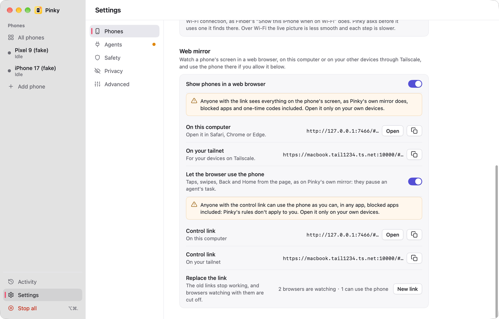
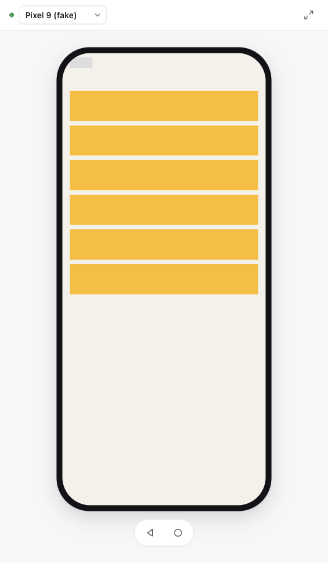
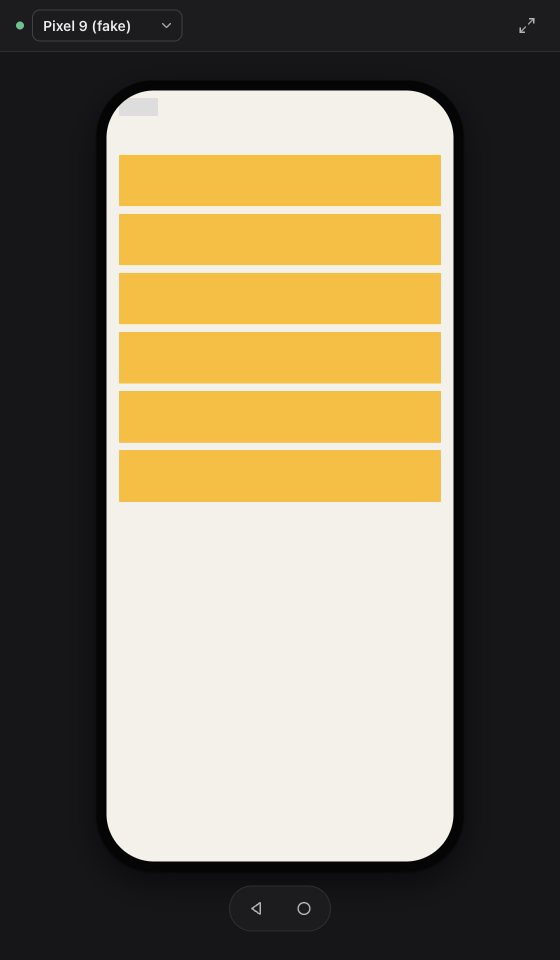
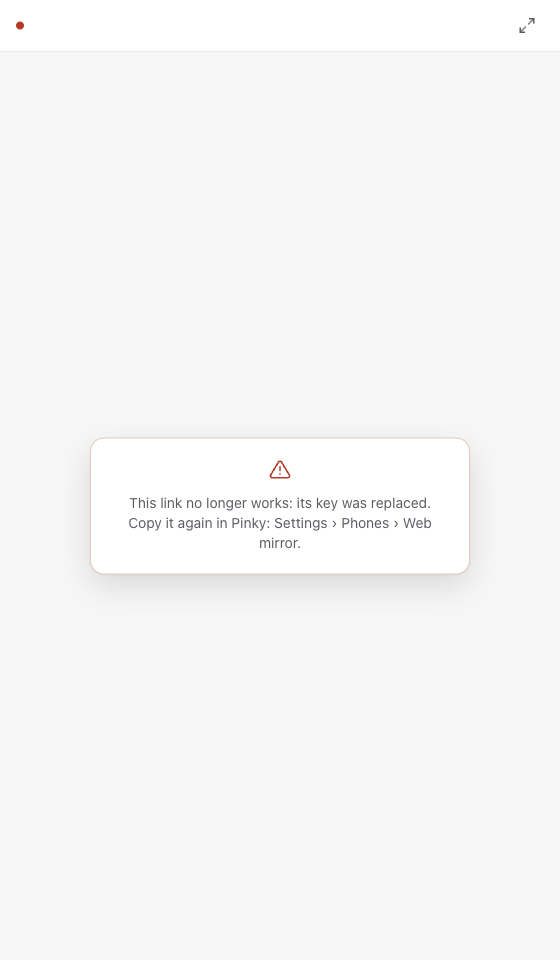

# Web mirror

Settings › Phones › Web mirror shows a phone's live screen in a web browser: on this computer, and on the person's other devices through Tailscale. With **Let the browser use the phone** on, a second link (the control link) also takes taps, drags, the wheel, Back and Home. `pinky daemon --mirror [--mirror-control]` turns it on without the app and prints the links.

Pictures from the fake phones (`pinky daemon --fake`) and the UI demo; never from a real phone.

| Settings › Phones › Web mirror | The page with the control link | Dark | A link with an old key |
| --- | --- | --- | --- |
|  |  |  |  |

## How it works

- `internal/webmirror` listens on `127.0.0.1:7466` only, never on another address. The page is `/`, its WebSocket `/ws`.
- The video is the phone's own stream, a member of the gateway's stream hub (`gateway.Stream`), like the window's mirror; nothing is decoded or encoded again on the computer. `codec.go` turns the Annex B packets into what WebCodecs takes: a codec string (`hvc1.…`, `avc1.…`) and an `hvcC`/`avcC` description from the parameter sets, sent as a JSON `config` message whenever they change, then each picture as a binary message: a flags byte (bit 0 key frame, bits 1–2 the quarter turns of `driver.Packet.Turn`), the time in µs (8 bytes, big-endian), and the NAL units with 4-byte lengths, without parameter sets or delimiters.
- The page checks `VideoDecoder.isConfigSupported` and says so when the browser cannot decode the codec (HEVC from iPhones), when it lacks WebCodecs, or when the page is not a secure context (WebCodecs needs HTTPS, or `http://127.0.0.1`).
- Key frames: a viewer joining late gets the configuration and the pictures since the last key frame from the hub. When the page cannot decode a picture, or decodes slower than the phone sends, it asks for a key frame (`{"type":"keyframe"}`); the server asks the phone through the gateway's viewer (`RequestKeyFrame`, added to `internal/gateway/streams.go`) and drops pictures until one comes. When the pictures sent fall more than 1.5 s behind the phone (a slow network), the server skips to the next key frame too.

## Using the phone from the page

- Input goes to the gateway's `Touch` and `Key`, the window mirror's own, so it pauses an agent's task as touching the mirror does (`personInput`, takeover). `webmirror.Source` has only those two of the gateway's input methods: the page cannot reach approvals, unlocking or handing a task back. Handing back stays in Pinky's window; the page says so while the person is in control.
- Wire: `{"type":"touch","a":"down|move|up","x":0..1,"y":0..1,"turn":n}` across the upright picture the page shows, and `{"type":"key","key":"back|home"}`. The server maps the point as the window does (`toDevice`, then `turnPoint(p, W, H, (4-turn)&3)`) to the stream picture's pixels, its size taken from the decoder configuration (SPS sizes are already cropped, as the browser shows them). An iPhone's padding needs nothing: its driver clamps a point there to the screen's edge.
- `input.go`: each control connection sends its input in order through a queue of its own, off the WebSocket's reader (a touch may take the driver up to 10 s; key frame requests must not wait). Moves still queued are merged; downs and ups never are. A move or up without a down is dropped. Only one connection at a time holds a finger down on a phone. A finger still down when the connection ends is lifted: scrcpy's injection keeps no state, so it would stay down. The page lifts it too on pointer cancel, lost capture, blur, a hidden tab and pagehide.
- Page: Pointer Events with capture, at most one move per animation frame; the wheel is a finger dragging the content (down at the pointer, against the scroll, up 140 ms after the last notch, and down again where it started near the picture's edge), as `ui/mirrorwheel.go` does without its glide; right click is Back; Back and Home buttons in the bar, where the "you're in control" line also goes, so nothing moves the picture during a gesture.

## Security

- Off by default; only Settings (or `--mirror`) turns it on.
- Its own tokens, not the agent token: `mirror-token` can only watch, `mirror-control-token` can also use the phone (both 0600 in the config directory, random and independent). The control token works only while **Let the browser use the phone** is on; turning it off cuts off the pages using it, and a page that may only watch is cut off when it sends input. **New link** replaces both tokens. A link carries its token after `#`, which browsers do not send to servers or proxies; the page sends it as its first WebSocket message.
- Through Tailscale, the control link also needs a person signed in to the tailnet: `tailscale serve` names them in `Tailscale-User-Login` (and drops a copy the client sent). Tailscale Funnel's public requests and tagged devices carry no user ([Tailscale Serve](https://tailscale.com/docs/features/tailscale-serve), [identity headers](https://tailscale.com/docs/concepts/tailscale-identity)), so a control link reached through Funnel is refused.
- The page moves the token from the link into the tab's session storage and takes it out of the address bar, so it stays out of the history and of a copied URL.
- Input from the control link is the person's own, as on the window mirror: Pinky's rules (blocked apps, asks) do not apply to it. A process of the same user that can read the config directory can read the control token, which gives it a way to use an iPhone that it did not have before (an agent with a shell already had adb for Android); hence off by default, and only while the person allows control.
- Requests must name this computer (localhost, a loopback address, or its tailnet name, which `tailscale serve` forwards under); the WebSocket must come from the page's own origin. `Tailscale-User-Login` is logged, and required for control under the tailnet name, but it is never enough by itself: a local process can send it to 127.0.0.1, so every page still needs a token.
- It shows what the window's mirror shows, blocked apps and one-time codes included: the window's mirror covers nothing either (only screenshots, history and recordings do), so Settings warns about it.

## Reaching it through Tailscale

Pinky never runs `tailscale serve`. While Tailscale is connected and does not forward to the mirror yet, Settings shows the command, such as `tailscale serve --bg --https=8443 7466`, with an HTTPS port the person's `tailscale serve` does not use yet (8443, else 10000, 9443, 7443, 4443): taking one in use would replace what is served there. Once it runs, Settings shows the tailnet link, `https://<computer>.<tailnet>.ts.net:<port>/#<token>`. `tailscale serve --https=<port> off` stops it.

## Tested (2026-11-11, macOS, ego lite / Chromium)

- Fake phones (`pinky daemon --fake --mirror`): H.264 picture, switching phones, wrong and missing key. With `--mirror-control`: a tap opened a row of the fake Pixel, Back went back, the view link showed no controls.
- iPhone 13 Pro, iOS, over USB: HEVC, live. Pixel 8 Pro, scrcpy H.264, live.
- Not tested: Safari, another device through `tailscale serve`, a phone turned sideways (`Turn`; `toPicture` has table tests), input on a real phone.

## Known limits

- An iPhone pads its picture (1184×2576 for a 1170×2532 screen); the page shows the padding as a thin black edge, as the stream has it.
- One phone per page; the page lists the phones online when it connects.
